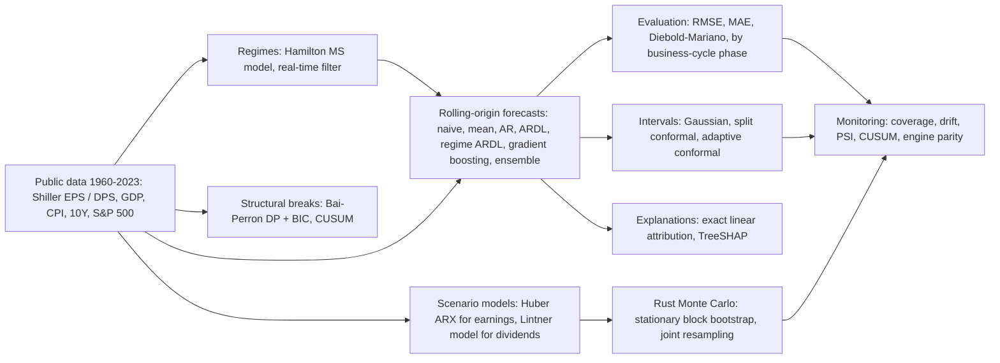
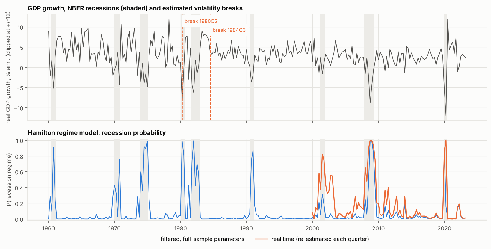
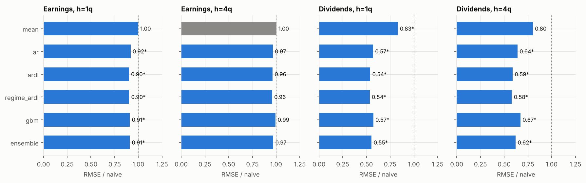
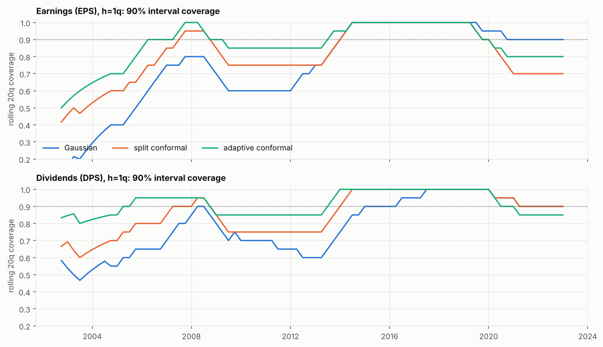
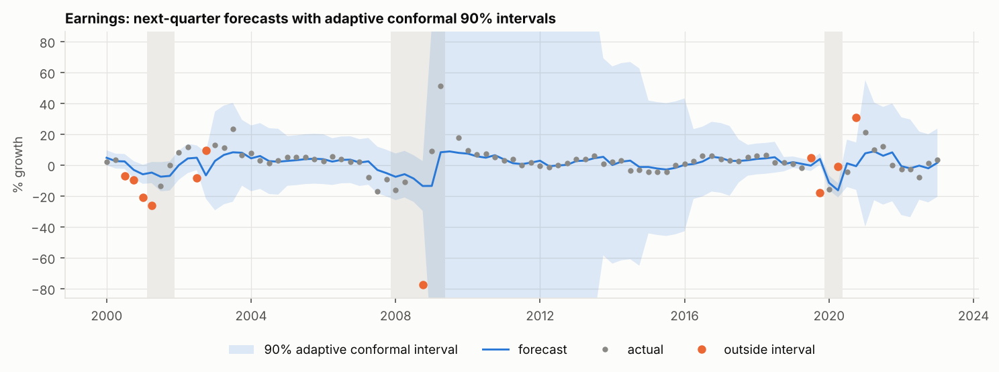
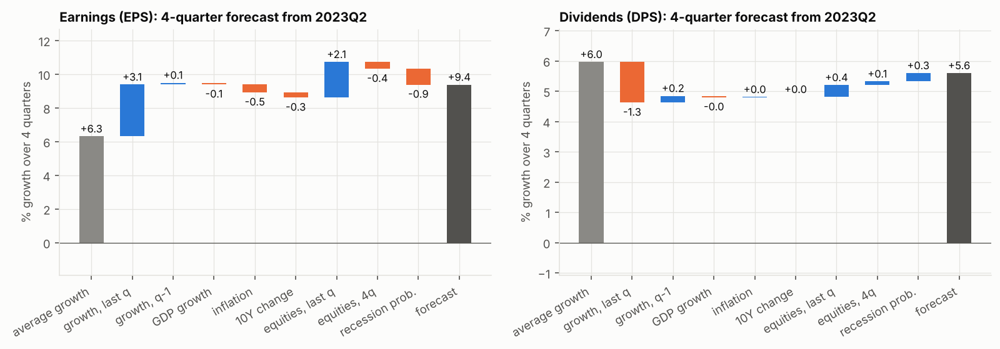
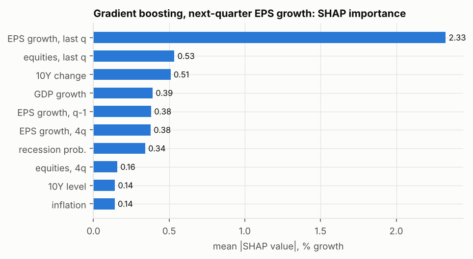
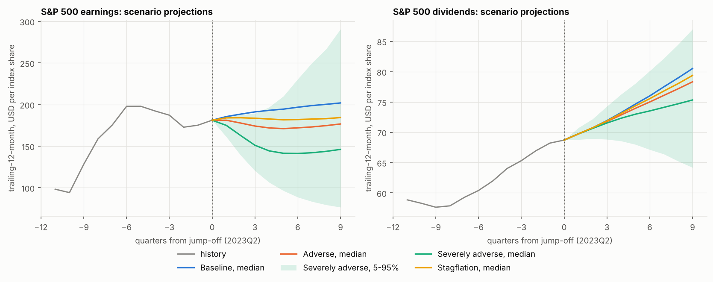

# PlanCast

**Forecasting financial line items under macroeconomic scenarios: regime detection and structural breaks, econometric and explainable machine-learning forecasts evaluated in pseudo real time, calibrated uncertainty with conformal prediction, linked line items, and a Rust Monte Carlo engine.**

   

Budget planning needs three things from a forecasting model: a number, an honest range around it, and a story for how it moves under a macro scenario. PlanCast builds all three for two line items with very different behaviour, using 63 years of public data:

* **Earnings** (S&P 500 trailing EPS): cyclical, regime-dependent, hit by rare write-down shocks, like trading revenues;
* **Dividends** (S&P 500 trailing DPS): sticky and slow, linked to earnings, like an expense base.

```bash
pip install -e ".[dev]"
make rust                  # optional: build the Rust engine (a bit-identical NumPy fallback is used otherwise)
python -m plancast run     # writes reports/results.md, monitoring.md, metrics.json, figures/
pytest                     # 17 Python tests (incl. Rust/NumPy parity), plus `cargo test` in rust/
```

---

## Headline results

| | Finding |
|---|---|
| **Regimes** | A Hamilton Markov-switching model on GDP alone identifies NBER recessions with **AUC 0.987 in real time** (2000-2023, re-estimated each quarter with data available then). Recession regime: -2.2% annualised growth, expected duration 2.8 quarters. |
| **Structural breaks** | Bai-Perron estimation finds the **Great Moderation**: a GDP volatility break in **1984Q3** (growth volatility 3.9 pp in 1960-80, 5.5 pp in 1980-84, 2.3 pp after), and the 2007Q3-2011Q3 earnings write-down era. |
| **Forecasts** | Next-quarter earnings: every model with information beats the no-change forecast significantly (best RMSE -10%, MAE -19%, Diebold-Mariano p = 0.02). Dividends: **-47% RMSE** (p < 1e-13). Gradient boosting does not beat the linear models on 250 quarterly observations: reported as found. |
| **Uncertainty** | Gaussian 90% intervals cover only **74-80%** of outcomes and as little as 27% around recessions. Adaptive conformal inference brings coverage to **84-91%** without distributional assumptions. |
| **Scenarios** | Under the Fed-style severely adverse path (equities -58%), median earnings fall **26% peak to trough**, with a 5% tail of -64%. Dividends, linked to earnings through a Lintner payout model, barely move: stickiness that budget plans need to reflect. |
| **Engineering** | Monte Carlo kernel in **Rust** (PyO3), bit-identical to the NumPy reference and 2.5x faster than vectorised NumPy; exact TreeSHAP explanations; a no-look-ahead test; 16 PASS / 4 WARN monitoring report. |

All numbers come from `python -m plancast run`; full output in [`reports/results.md`](reports/results.md).

---

## Pipeline



## 1. Regimes and structural breaks



* **Hamilton (1989)** two-state model of GDP growth, with impulse dummies for the 2020Q2-Q3 lockdown quarters (otherwise one quarter becomes its own "regime"). The orange line is computed in real time: parameters re-estimated every four quarters on data available at the time, filtered (not smoothed) probabilities.
* **Bai and Perron (2003)** global least-squares break dates by dynamic programming, with the number of breaks chosen by BIC. Applied to absolute deviations it dates variance breaks: 1980Q2 and 1984Q3, the latter matching the Great Moderation literature (McConnell and Perez-Quiros, 2000).

## 2. Forecast accuracy

Direct forecasts of cumulative growth over the next 1 and 4 quarters. Every model is re-estimated at every quarter from 1985 with data available at that date (a test perturbs data after the origin and checks the forecast does not move); scores from 2000Q1. `*` = Diebold-Mariano test against no change significant at 5%.



| RMSE relative to no change | AR | ARDL | Regime ARDL | Gradient boosting | Ensemble |
|---|---|---|---|---|---|
| Earnings, next quarter | 0.92* | **0.90*** | 0.90* | 0.91* | 0.91* |
| Earnings, next 4 quarters | 0.97 | 0.96 | **0.96** | 0.99 | 0.97 |
| Dividends, next quarter | 0.57* | 0.54* | **0.54*** | 0.57* | 0.55* |
| Dividends, next 4 quarters | 0.64* | 0.59* | **0.58*** | 0.67* | 0.62* |

* Earnings training uses 2.5% winsorisation of own-growth features and targets (estimated on each training window): the 2008Q4 write-down quarter (-113% log growth) otherwise drives linear models into wild extrapolation. Evaluation is always on raw outcomes.
* Gradient-boosting scores can move in the third decimal across library versions (histogram binning); all other numbers reproduce exactly from a fresh install.
* Four-quarter earnings forecasts barely beat no change: the GFC quarters dominate squared errors. For planning, this says the range matters more than the point, which is what section 3 delivers.

## 3. Calibrated uncertainty

Production model: regime ARDL. Target coverage 90%, evaluated 2000-2023.



| Coverage of 90% intervals | Gaussian | Split conformal | **Adaptive conformal** |
|---|---|---|---|
| Earnings, next quarter | 76% | 80% | **86%** |
| Earnings, next 4 quarters | 74% | 78% | **84%** |
| Dividends, next quarter | 80% | 86% | **90%** |
| Dividends, next 4 quarters | 76% | 87% | **91%** |
| Earnings next quarter, around recessions | 27% | 45% | **55%** |

Adaptive conformal inference (Gibbs and Candes, 2021) moves its working quantile level after each miss, with delayed feedback when the horizon is longer than one quarter. It recovers coverage quickly after regime shifts; no method fully covers the 2008-09 write-downs.



## 4. Live forecast and explanations

Four-quarter growth forecasts from 2023Q2 (last observation), with exact driver attribution (linear model: coefficient times deviation from the sample mean, summing to the forecast):



| | Forecast, 4 quarters | Split conformal 90% | Adaptive conformal 90% |
|---|---|---|---|
| Earnings | +9.4% | [-27.7%, +46.5%] | unbounded |
| Dividends | +5.6% | [-0.5%, +11.7%] | [-0.5%, +11.7%] |

For earnings, the large 2020-2022 misses have pushed ACI's working level above 1: no finite interval built from the last 40 quarters of errors would have achieved 90% coverage. Rather than reporting false precision, the method says so, and the drift check in the monitoring report flags the same model.



TreeSHAP (exact, additivity checked to 1e-14) on the gradient-boosting model: last quarter's earnings growth dominates, followed by equity returns and rate changes.

## 5. Scenario projections

* **Earnings**: ARX model on the macro scenario (GDP, inflation, 10Y change, equity return), estimated by **Huber M-estimation** so the write-down quarters do not distort coefficients.
* **Dividends**: a **Lintner (1956)** partial-adjustment model: dividends follow lagged earnings growth (t = 3.3, 3.5) and mean-revert to a target payout ratio (t = -3.3). They are simulated *on top of* each earnings path: a linked line item, as expenses are to revenues in a budget.
* **Uncertainty**: 20,000 paths, residuals drawn with the stationary block bootstrap (Politis and Romano, 1994), keeping crisis clustering; both items draw their shocks from the **same historical quarters**, preserving their correlation.



| 9 quarters from 2023Q2 | Earnings: median change | Earnings: median drawdown | Earnings: 5% worst drawdown | Dividends: median change | Dividends: 5% worst drawdown |
|---|---|---|---|---|---|
| Baseline | +11.5% | -6.1% | -54.3% | +17.2% | -5.0% |
| Adverse | -2.5% | -12.0% | -56.6% | +14.0% | -6.4% |
| Severely adverse (equities -58%) | **-19.4%** | **-25.8%** | -63.8% | +9.6% | -9.5% |
| Stagflation | +1.8% | -9.4% | -54.9% | +15.5% | -5.5% |

Even the baseline has a fat 5% tail for earnings: the bootstrap keeps write-down shocks in the distribution, as history says it should.

### Rust engine

`rust/` holds the Monte Carlo kernel (ARX recursion with stationary block-bootstrap shocks), exposed to Python with PyO3 and rust-numpy (zero-copy arrays). Random numbers are passed in from Python so the Rust and NumPy implementations are **bit-for-bit identical** (tested); the Rust kernel runs 200,000 x 9-quarter paths in 22 ms versus 55 ms for vectorised NumPy. `cargo test` covers the recursion, block continuation and input validation; CI runs `cargo fmt`, `clippy -D warnings` and the parity test.

## 6. Monitoring

[`reports/monitoring.md`](reports/monitoring.md), regenerated on every run: real-time regime AUC, interval coverage, SHAP additivity, engine parity and joint-resampling checks, economic sign checks, CUSUM stability tests, standardised forecast errors, and population-stability indices of the drivers. Current status **16 PASS, 4 WARN, 0 FAIL**; the warnings are informative, not failures: four-quarter earnings coverage at 84%, a recent large four-quarter earnings miss, and post-Covid drift in GDP and equity-return distributions.

## Repository layout

```
plancast/
├── configs/default.yaml        # sample, models, horizons, interval settings, macro scenarios
├── data/raw/                   # public data snapshot (see data/README.md)
├── docs/methodology.md         # equations, choices, references, limitations
├── reports/                    # generated: results.md, monitoring.md, metrics.json, figures/
├── rust/                       # PyO3 Monte Carlo kernel (Cargo crate + maturin build)
├── scripts/fetch_data.py       # refresh the snapshot
├── src/plancast/
│   ├── data.py                 # panel construction, NBER chronology (evaluation only)
│   ├── regimes.py              # Hamilton model and real-time filter, Bai-Perron breaks, CUSUM
│   ├── forecast.py             # features, models, rolling-origin evaluation, Diebold-Mariano
│   ├── conformal.py            # Gaussian, split and adaptive conformal intervals
│   ├── scenarios.py            # Huber ARX, Lintner model, bootstrap, Rust / NumPy engines
│   ├── pipeline.py             # end-to-end run and report
│   └── plotting.py, report.py
└── tests/                      # pytest suite; cargo tests live in rust/src/lib.rs
```

## Design choices worth discussing

* **Why direct multi-horizon forecasts?** One model per horizon avoids compounding a misspecified one-step model; the 4-quarter target is what a budget needs.
* **Why winsorise training data but evaluate on raw outcomes?** Write-down quarters are real and must be scored, but they should not set slope coefficients for normal quarters.
* **Why conformal rather than bootstrapped model intervals?** Conformal coverage holds without a distributional model; the adaptive version repairs coverage after breaks, which is exactly when planners need it.
* **Why link dividends to simulated earnings?** Driving every line item off the macro paths independently breaks the accounting logic between them; linkage plus joint resampling keeps it.
* **Why keep a NumPy implementation next to Rust?** It is the specification: bit-identical outputs make the compiled kernel auditable by model validation.

## Limitations

Latest-vintage data (not real-time vintages), quarterly sample of about 250 observations, S&P 500 aggregates as stand-ins for a firm's own line items, no parameter uncertainty in scenario paths, and NBER dates used only for evaluation. Details in [`docs/methodology.md`](docs/methodology.md#limitations).

## Data

R. Shiller's S&P 500 data, BEA GDP, BLS CPI and the Federal Reserve 10Y yield, via the datahub.io core datasets; see [`data/README.md`](data/README.md). Refresh with `python scripts/fetch_data.py`.

## Author

Amir Masominia. PhD in physics (Université Paris-Saclay); postdoctoral researcher working on machine-learning surrogate models, numerical simulation and automated measurement pipelines.

License: MIT.
